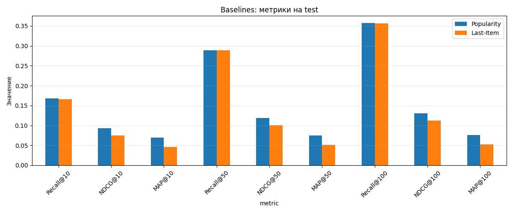

# RL-дообучение рекомендательной модели на датасете KION

Исследовательский проект: дообучение последовательной рекомендательной модели
с помощью обучения с подкреплением (RL) для оптимизации долгосрочных целей
(доля досмотра контента) вместо краткосрочных (клик, лайк) с минимальной потерей релевантности результатов.

---

## Содержание
- [1. Цель проекта](#1-цель-проекта)
- [2. Датасет](#2-датасет)
- [3. Сплит данных](#3-сплит-данных)
- [4. Метрики](#4-метрики)
- [5. Бейзлайны](#5-бейзлайны)
- [6. Базовая GPT-2 (next item prediction)](#6-базовая-gpt-2-next-item-prediction)
- [7. Reward Model](#7-reward-model)
- [8. RL-дообучение](#8-rl-дообучение)
- [9. Анализ](#9-анализ)
- [10. Ограничения](#10-ограничения)
- [11. Воспроизведение](#11-воспроизведение)
- [12. Структура репозитория](#12-структура-репозитория)

---

## 1. Цель проекта

Стандартные рекомендательные системы оптимизируют **краткосрочные** цели:
число кликов, лайков, покупок. Это приводит к кликбейту без удержания пользователя
и повторяющимся рекомендациям в ущерб долгосрочной удовлетворённости пользователя.

**Что исследуется:** можно ли дообучить последовательную рекомендательную модель
с помощью RL так, чтобы она максимизировала **долю просмотра** контента
(`watched_pct`) — прокси долгосрочного интереса.

**Главный вопрос исследования:** удаётся ли улучшить reward **без потери
релевантности** рекомендаций (снижения Recall, NDCG, MAP)?

Положительный эффект не гарантирован: содержательный разбор того,
почему подход не сработал, тоже является ценным результатом.

---

## 2. Датасет

Используется **KION Dataset** от МТС — датасет рекомендаций для онлайн-кинотеатра.

| Параметр | Значение |
|----------|----------|
| Источник | [irsafilo/KION_DATASET](https://github.com/irsafilo/KION_DATASET) |
| Взаимодействий | 5 476 251 |
| Пользователей | 962 179 |
| Контента | 15 706 |
| Диапазон дат | 13.03.2021 — 22.08.2021 (162 дня) |

**Ключевое поле:** `watched_pct` — доля просмотра контента от 0 до 100.
Используется как целевая переменная reward model.

**Наблюдения из EDA:**
- **Repeat rate = 0%**. Каждый пользователь смотрит каждый фильм ровно один раз.
- 36.9% пользователей имеют ровно 1 взаимодействие (long-tail).
- Распределение `watched_pct` бимодальное: пики на 0 (закрыл сразу) и 100 (досмотрел).
- Платформа быстро растёт: в марте ~15k взаимодействий/день, в августе ~60k.
- 828 строк (0.015%) с NaN в `watched_pct` — удалены.

**Скачивание:**

```bash
curl -L -o data/raw/data_en.zip \
  https://github.com/irsafilo/KION_DATASET/raw/f69775be31fa5779907cf0a92ddedb70037fb5ae/data_en.zip
unzip data/raw/data_en.zip -d data/raw/
```

---

## 3. Сплит данных

Используется глобальный сплит именно **по времени** для
исключения утечки данных из будущего.

**Фильтр холодных:** остаются только те пользователи и айтемы,
которые встречаются в train. Это уменьшает val/test, но гарантирует,
что модель видела историю пользователя.

### Размеры сплитов

| Сплит | Период | До фильтра | После фильтра | Доля |
|-------|--------|-----------:|--------------:|-----:|
| Train | 13.03 — 23.07.2021 | 3 787 046 | 3 787 046 | 82.0% |
| Val   | 24.07 — 03.08.2021 |   583 822 |   371 021 |  8.0% |
| Test  | 04.08 — 22.08.2021 |   1 104 555 |   474 130 | 10.0% |
| **Итого** | | **5 475 423** | **4 632 197** | **100%** |

Большая часть test теряется, и в данном случае это нормально (см. [10. Ограничения](#10-ограничения)).

**Протокол оценки:** для каждого пользователя берётся последний по времени просмотр в test как целевой айтем (next-item prediction). Итого 132 323 таргета.

---

## 4. Метрики

| Метрика | Что измеряет | Формула (для одного таргета) | Диапазон |
|---------|--------------|------------------------------|----------|
| **Recall@K** | Попал ли правильный айтем в топ-K | `1 if rank ≤ K else 0` | 0…1 |
| **NDCG@K** | Попал ли правильный айтем **высоко** в списке | `1 / log2(rank + 1)` | 0…1 |
| **MAP@K** | Как быстро найден правильный айтем | `1 / rank` | 0…1 |

где `rank` — позиция правильного айтема в ранжированном списке (1-индексированная).

**Значения K:** 10, 50, 100 — три сценария использования:
- `K=10` — реальный экран рекомендаций;
- `K=50` — «широкая» выдача;
- `K=100` — верхняя граница для оценки покрытия.

K считается по *полному каталогу*, без сэмплирования негативов — сэмплированные метрики ранжируют модели некорректно.

*Главной метрикой проекта* будет выступать **NDCG@10** как самая сбалансированная. Recall и MAP используем как вспомогательные.

**Протокол:** один таргет на пользователя (last item в test), top-200 рекомендаций,
без маскирования уже просмотренного (на baseline-этапе).

---

## 5. Бейзлайн

Реализованы два тривиальных алгоритма, чтобы задать планку для GPT-2.

**Popularity** — рекомендует всем один и тот же топ-200 популярных айтемов из train.

**Last-Item** — рекомендует пользователю айтем, который он смотрел последним в train,
с popular-айтемами в хвосте списка.

### Результаты на test

| Метрика | Popularity | Last-Item | Δ |
|---------|-----------:|----------:|--:|
| Recall@10   | **0.1685** | 0.1662 | −0.0023 |
| NDCG@10     | **0.0931** | 0.0745 | −0.0186 |
| MAP@10      | **0.0696** | 0.0459 | −0.0237 |
| Recall@50   | **0.2892** | **0.2892** | 0.0000 |
| NDCG@50     | **0.1190** | 0.1008 | −0.0182 |
| MAP@50      | **0.0747** | 0.0512 | −0.0235 |
| Recall@100  | **0.3574** | 0.3566 | −0.0008 |
| NDCG@100    | **0.1302** | 0.1118 | −0.0184 |
| MAP@100     | **0.0757** | 0.0522 | −0.0235 |



---

## 6. Базовая GPT-2 (next item prediction)
### TO_DO
## 7. Reward Model
### TO_DO
## 8. RL-дообучение
### TO_DO
## 9. Анализ
### TO_DO

---

## 10. Ограничения
- Из-за роста платформы теряется примерно 76% test —
большая часть взаимодействий приходится на пользователей, которых не было в train.
Это создаёт оптимистичное смещение метрик (оениваются только «тёплые» юзеры).
- Маскировка уже просмотренных айтемов не нужна. В данном датасете это не влияет на метрики: **repeat rate = 0%**

---

## 11. Воспроизведение
```bash
# 1. Клонировать репозиторий
git clone https://github.com/Sladkiy-Bo/TLabExam
cd kion-recsys-rl

# 2. Виртуальное окружение
python -m venv .venv
source .venv/bin/activate  # Windows: .venv\Scripts\activate

# 3. Установить зависимости
pip install -r requirements.txt

# 4. Скачать датасет (см. раздел 2)
curl -L -o data/raw/data_en.zip <URL>
unzip data/raw/data_en.zip -d data/raw/

# 5. Подготовить сплиты
cd src && python data.py && cd ..

# 6. Запустить ноутбуки
jupyter notebook notebooks/
# 01_eda.ipynb → EDA
# 02_baselines.ipynb → метрики baseline-ов
```

---

## 12. Структура репозитория

```test
TLabExam/
├── data/
│   ├── raw/                # исходные CSV (не коммитятся)
│   └── processed/          # train/val/test.parquet
├── notebooks/
│   ├── 01_eda.ipynb        # разведочный анализ
│   └── 02_baselines.ipynb  # оценка baseline-ов
├── src/
│   ├── data.py             # загрузка + временной сплит + фильтр холодных
│   ├── metrics.py          # Recall@K, NDCG@K, MAP@K
│   └── baselines.py        # Popularity, Last-Item
├── results/
│   ├── baselines_metrics.csv
│   └── baselines_metrics.png
├── requirements.txt
├── .gitignore
└── README.md
```