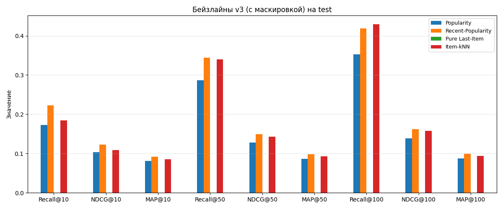
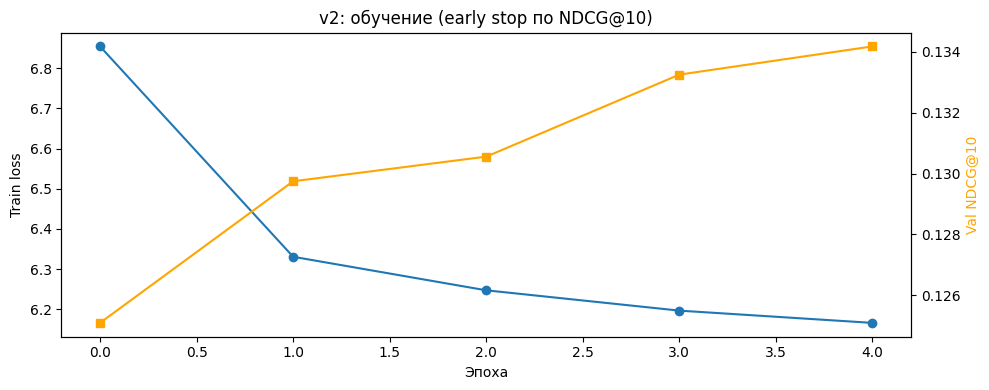
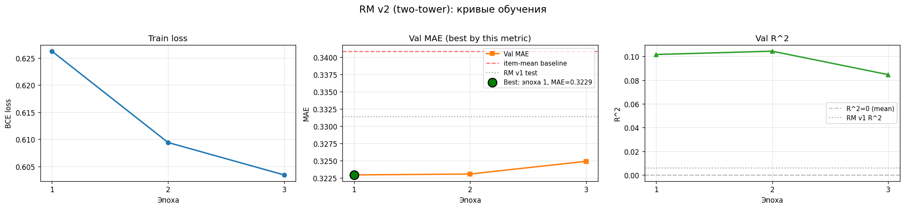
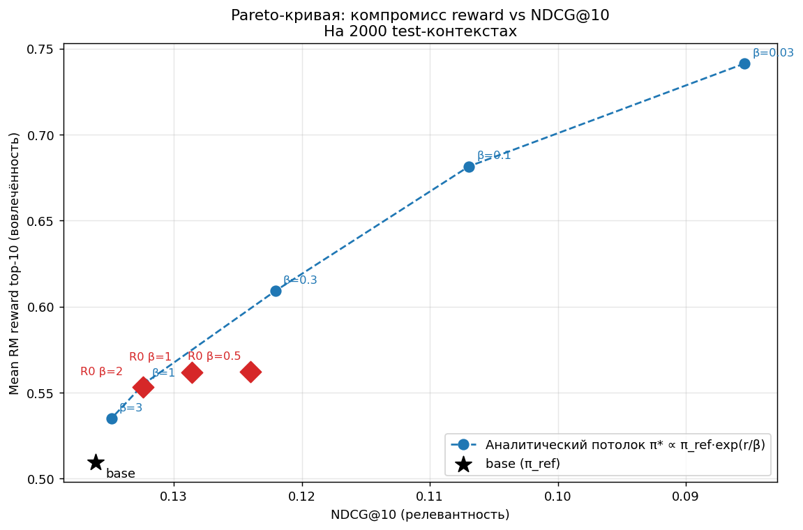
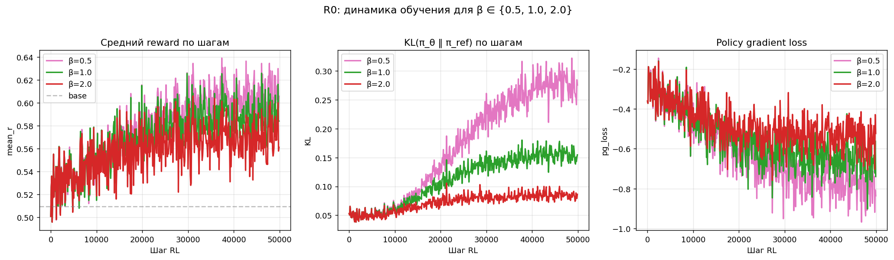
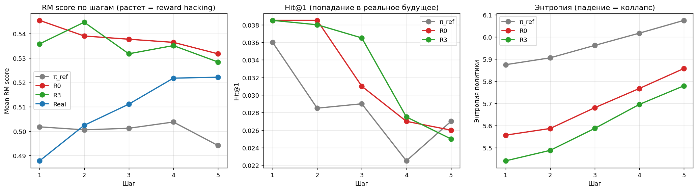
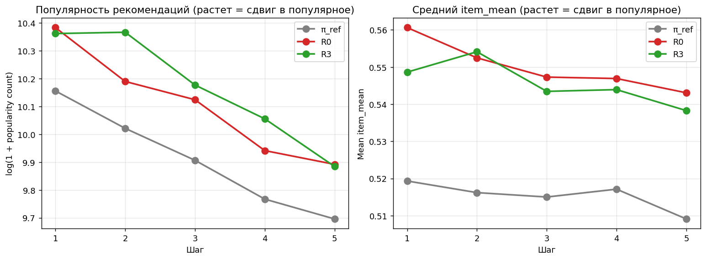

# RL-дообучение рекомендательной модели на датасете KION

Исследовательский проект: дообучение последовательной рекомендательной модели
с помощью обучения с подкреплением (RL) для оптимизации долгосрочных целей
(доля досмотра контента) вместо краткосрочных (клик, лайк) с минимальной потерей релевантности результатов.

---

## Содержание
- [1. Цель проекта](#1-цель-проекта)
- [2. Датасет](#2-датасет)
- [3. Сплит данных](#3-сплит-данных)
- [4. Метрики](#4-метрики)
- [5. Бейзлайны](#5-бейзлайны)
- [6. Базовая GPT-2 (next item prediction)](#6-базовая-gpt-2-next-item-prediction)
- [7. Reward Model](#7-reward-model)
- [8. RL-дообучение](#8-rl-дообучение)
- [9. Мультишаговая генерация](#9-мультишаговая-генерация)
- [10. Анализ](#10-анализ)
- [11. Ограничения](#11-ограничения)
- [12. Воспроизведение](#12-воспроизведение)
- [13. Структура репозитория](#13-структура-репозитория)

---

## 1. Цель проекта

Стандартные рекомендательные системы оптимизируют **краткосрочные** цели:
число кликов, лайков, покупок. Это приводит к кликбейту без удержания пользователя
и повторяющимся рекомендациям в ущерб долгосрочной удовлетворённости пользователя.

**Что исследуется:** можно ли дообучить последовательную рекомендательную модель
с помощью RL так, чтобы она максимизировала **долю просмотра** контента
(`watched_pct`) - прокси долгосрочного интереса.

**Главный вопрос исследования:** удаётся ли улучшить reward **без потери
релевантности** рекомендаций (снижения Recall, NDCG, MAP)?

*Положительный эффект не гарантирован: содержательный разбор того, почему подход не сработал, тоже является ценным результатом.*

---

## 2. Датасет

Используется **KION Dataset** от МТС - датасет рекомендаций для онлайн-кинотеатра.

| Параметр | Значение |
|----------|----------|
| Источник | [irsafilo/KION_DATASET](https://github.com/irsafilo/KION_DATASET) |
| Взаимодействий | 5 476 251 |
| Пользователей | 962 179 |
| Контента | 15 706 |
| Диапазон дат | 13.03.2021 - 22.08.2021 (162 дня) |

**Ключевое поле:** `watched_pct` - доля просмотра контента от 0 до 100.
Используется как целевая переменная reward model.

### **Наблюдения из EDA:**
- **Repeat rate = 0%**. Каждый пользователь смотрит каждый фильм ровно один раз.
- 36.9% пользователей имеют ровно 1 взаимодействие (long-tail).
- Распределение `watched_pct` бимодальное: пики на 0 (закрыл сразу) и 100 (досмотрел).
- Платформа быстро растёт: в марте ~15k взаимодействий/день, в августе ~60k.
- 828 строк (0.015%) с NaN в `watched_pct` - удалены.

### Временной дрейф в `watched_pct`

Распределение целевой переменной `watched_pct` значимо различается между
сплитами. Это важное свойство данных, влияющее на интерпретацию метрик.

| Сплит | Период | mean | pct=0 | **pct=100** |
|-------|--------|-----:|------:|------------:|
| train | 13.03 - 23.07 | 0.527 | 10.4% | **32.5%** |
| val   | 24.07 - 03.08 | 0.440 | 10.6% | **18.8%** |
| test  | 04.08 - 22.08 | 0.433 | 10.9% | **18.8%** |

**Наблюдается два эффекта:**

1. **Сезонность.** Train охватывает март–июнь (весна), val/test - июль–август
   (лето). Вероятно, летом пользователи менее склонны досматривать длинный контент.
2. **Отбор когорт.** В train попали более ранние и тёплые пользователи.
   Val/test содержат новые когорты с меньшей средней вовлечённостью.

**Исправление не производится.** Drift - естественное свойство растущей
платформы, а не артефакт данных. Он зафиксирован как ограничение (см. [11. Ограничения](#11-ограничения)).

### **Скачивание:**

```bash
curl -L -o data/raw/data_en.zip \
  https://github.com/irsafilo/KION_DATASET/raw/f69775be31fa5779907cf0a92ddedb70037fb5ae/data_en.zip
unzip data/raw/data_en.zip -d data/raw/
```

---

## 3. Сплит данных

Используется глобальный сплит именно **по времени** для
исключения утечки данных из будущего.

**Фильтр холодных:** остаются только те пользователи и айтемы,
которые встречаются в train. Это уменьшает val/test, но гарантирует,
что модель видела историю пользователя.

### Размеры сплитов

| Сплит | Период | До фильтра | После фильтра | Доля |
|-------|--------|-----------:|--------------:|-----:|
| Train | 13.03 - 23.07.2021 | 3 787 046 | 3 787 046 | 82.0% |
| Val   | 24.07 - 03.08.2021 |   583 822 |   371 021 |  8.0% |
| Test  | 04.08 - 22.08.2021 |   1 104 555 |   474 130 | 10.0% |
| **Итого** | | **5 475 423** | **4 632 197** | **100%** |

Большая часть test теряется, и в данном случае это нормально (см. [11. Ограничения](#11-ограничения)).

**Протокол оценки:** в качестве **таргета** выбирается множество айтемов, с которыми пользователь взаимодействовал на *следующий активный день* после *последнего активного дня в соответствующем сплите*.
Протокол выбран так, чтобы приблизить офлайн-оценку к реальному
сценарию рекомендации: **рекомендация появляется сейчас, и пользователь смотрит в ближайшие минуты**. Это позволяет избежать «предсказания таргета через неделю после последнего контакта».

**Контекст** (история пользователя, доступная модели):

- для val:  история в train;
- для test: история в train + val.

| Сплит | Таргетов (пар user-item) | Пользователей | Ср. таргетов на юзера |
|-------|-------------------------:|--------------:|----------------------:|
| Val   | 176 224 | 118 727 | 1.48 |
| Test  | 186 690 | 132 323 | 1.41 |

**Почему именно такой протокол?** Во избежания ситуации, когда последний просмотр придётся на конец test-сплита, т. е. между ним и последним взаимодействием из контекста пройдёт максимальный период времени (19 дней), а предсказание какого-то клика на основе данных трёхнедельной давности - **нечестная задача**.

---

## 4. Метрики

| Метрика | Что измеряет | Формула (для одного таргета) | Диапазон |
|---------|--------------|------------------------------|----------|
| **Recall@K** | Попал ли правильный айтем в топ-K | `1 if rank ≤ K else 0` | 0…1 |
| **NDCG@K** | Попал ли правильный айтем **высоко** в списке | `1 / log2(rank + 1)` | 0…1 |
| **MAP@K** | Как быстро найден правильный айтем | `1 / rank` | 0…1 |

где `rank` - позиция таргета в ранжированном списке (1-индексированная).

Метрики считаются **per target**: если у пользователя 3 таргета
в первом активном дне, каждый даёт вклад в среднее. Это устойчивее,
чем оценка по одному таргету.

**Значения K:** 10, 50, 100 - три сценария использования:
- `K=10` - реальный экран рекомендаций;
- `K=50` - «широкая» выдача;
- `K=100` - верхняя граница для оценки покрытия.

K считается по *полному каталогу*, без сэмплирования негативов - сэмплированные метрики ранжируют модели некорректно.

*Главной метрикой проекта* будет выступать **NDCG@10** как самая сбалансированная. Recall и MAP используем как вспомогательные: Recall показывает «нашли ли
 вообще», MAP - «как быстро»

---

## 5. Бейзлайн

Реализовано **4 классических бейзлайна**, чтобы задать честную планку для GPT-2.
*Все с **маскировкой уже просмотренного**, что критично, так как repeate rate = 0%* (см. [11. Ограничения](#11-ограничения))
Все используют один интерфейс `predict(user, context_items, last_date)`,
что позволяет сравнивать их по одному протоколу.

| Бейзлайн | Логика | Сложность |
|----------|--------|-----------|
| **Popularity** | Топ-500 за весь train (с маскировкой) | O(1) |
| **Recent-Popularity** | Топ-500 за 7 дней до границы T2 (для test), из train+val | O(1) |
| **Pure Last-Item** | Только последний просмотренный (без fallback) | O(1) |
| **Item-kNN** | Айтемы, часто встречающиеся вместе с историей | O(K) |

**Окно Recent-Popularity** подобрано на val: 3 дня выигрывают по NDCG@10
(0.1190 vs 0.1176 для 7 дней), но разница минимальна; выбрали **7 дней**
как компромисс между «свежестью» и «устойчивостью к выбросам».

**Last-Item+FB** (с popular fallback) не включён в таблицу: после маскировки
он **эквивалентен Popularity** (fallback = тот же popular-список), поэтому
не даёт новой информации. Оставлен только Pure Last-Item как доказательство,
что «last item» как стратегия не работает при нулевом repeat rate.

### Результаты на test

Метрики на 186 690 таргетах (first active day per user).

| Метрика | Popularity | **Recent-Popularity** | Pure Last-Item | Item-kNN |
|---------|-----------:|----------------------:|---------------:|---------:|
| Recall@10  | 0.1726 | **0.2230** | 0.0000 | 0.1842 |
| NDCG@10    | 0.1032 | **0.1229** | 0.0000 | 0.1091 |
| MAP@10     | 0.0814 | **0.0923** | 0.0000 | 0.0859 |
| Recall@50  | 0.2871 | **0.3436** | 0.0000 | 0.3402 |
| NDCG@50    | 0.1279 | **0.1498** | 0.0000 | 0.1429 |
| MAP@50     | 0.0863 | **0.0981** | 0.0000 | 0.0929 |
| Recall@100 | 0.3529 | 0.4190 | 0.0000 | **0.4298** |
| NDCG@100   | 0.1386 | 0.1620 | 0.0000 | 0.1575 |
| MAP@100    | 0.0873 | 0.0992 | 0.0000 | 0.0942 |



### Наблюдения

1. **Recent-Popularity - сильнейший классический бейзлайн.** Он бьёт Popularity
   на **+19% по NDCG@10** (0.1032 -> 0.1229). У быстро растущей платформы
   свежие хиты предсказывают следующий просмотр лучше, чем вечные
   популярные. Это **важный сигнал**: пользователи смотрят новинки.

2. **Item-kNN проигрывает Recent-Popularity по NDCG/MAP на малых K**
   (0.1091 vs 0.1229), но **сравнивается на больших K** (0.1575 vs 0.1620 на
   NDCG@100). Item-kNN ловит похожее на историю, а Recent-Pop - что сейчас
   в тренде. Разные сигналы.

3. **Pure Last-Item = 0.** Прямое следствие repeat rate = 0%. Last-Item как
   стратегия невозможна на этом датасете.

4. **Маскировка поднимает все метрики**, особенно у Popularity (+14.5% по
   NDCG@10: 0.0901 -> 0.1032). Без неё модели «тратят» слоты топа на уже
   просмотренное.


### Планка для GPT-2

GPT-2 должна побить **Recent-Popularity**:
- NDCG@10 > **0.1229** - критерий успеха;
- Recall@10 > **0.2230** - желательно;
- NDCG@100 > **0.1620** - проверка, что модель хорошо работает
  на всём диапазоне K.

---

## 6. Базовая GPT-2 (next item prediction)

### Архитектура

Модель - **GPT-2 с нуля** (без предобученных весов), сконфигурированная
под задачу next-item prediction (**2 315 136 параметров**)

| Параметр | Значение |
|----------|---------:|
| `n_layer` | 2 |
| `n_head` | 4 |
| `n_embd` | 128 |
| `n_positions` | 50 |
| `vocab_size` | 14 937 |
| `dropout` | 0.2 |

**Почему такая маленькая модель:** для последующего RL важна **скорость итераций**, а не
максимальное качество. По результатам теста видно, что данной эффективности модели достаточно, чтобы впоследствии использовать её как референсную политику для RL.

### Данные для обучения

- **Формат:** последовательности item_id, паддинг **слева** до `max_len=50`.
- **Почему слева:** GPT-2 использует каузальную маску (предсказывает i-ый элемент на основе множеста (0, i-1)) и не должен учиться предсказывать паддинг (что и случится, если PAD будет справа).
- **Спец-токены:** `PAD=0`, `UNK=1`, реальные айтемы с 2.
- **Отфильтровано:** юзеры с 1 айтемом (нечего предсказывать).
  Осталось **451 120** обучающих примеров из 727 645 юзеров.

### Обучение

**v1 (базовая):** 3 эпохи, early stop по val loss.
**v2 (финальная):** 5 эпох, early stop по **NDCG@10 на val** (правильный протокол),
`kind='stable'` в сортировке, `bfloat16` не использовался.

| Параметр | Значение |
|----------|---------:|
| Оптимизатор | AdamW |
| Learning rate (пик) | 1e-3 |
| Weight decay | 0.01 |
| Scheduler | Cosine с warmup (10%) |
| Batch size | 256 |
| Max epochs | 3 |
| Gradient clipping | 1.0 |
| Dropout | 0.2 |
| Loss | CrossEntropy (ignore PAD) |

**Val NDCG@10 по эпохам (v2):** 0.1251 -> 0.1297 -> 0.1306 -> 0.1333 -> **0.1342**.
Модель **не переобучилась** - стабильный рост на всех эпохах.



### Результаты на test

Метрики на 186 690 таргетах (first active day per user).

| Метрика | Popularity | Recent-Pop | Item-kNN | GPT-2 v1 | **GPT-2 v2** |
|---------|-----------:|-----------:|---------:|---------:|-------------:|
| Recall@10  | 0.1726 | **0.2230** | 0.1842 | 0.2175 | 0.2192 |
| NDCG@10    | 0.1032 | 0.1229 | 0.1091 | 0.1292 | **0.1304** |
| MAP@10     | 0.0814 | 0.0923 | 0.0859 | 0.1020 | **0.1030** |
| Recall@50  | 0.2871 | 0.3436 | 0.3402 | 0.3699 | **0.3714** |
| NDCG@50    | 0.1279 | 0.1498 | 0.1429 | 0.1625 | **0.1638** |
| MAP@50     | 0.0863 | 0.0981 | 0.0929 | 0.1090 | **0.1101** |
| Recall@100 | 0.3529 | 0.4190 | 0.4298 | 0.4557 | **0.4592** |
| NDCG@100   | 0.1386 | 0.1620 | 0.1575 | 0.1764 | **0.1780** |
| MAP@100    | 0.0873 | 0.0992 | 0.0942 | 0.1102 | **0.1113** |

**Прирост GPT-2 v2 относительно бейзлайнов (NDCG@10):**
- к Popularity: **+26.3%**
- к Item-kNN: **+19.5%**
- к Recent-Popularity: **+6.1%**

**Улучшение v2 над v1:** +0.8% (Recall@10), +0.9% (NDCG@10),
+1.0% (MAP@10) - небольшое, но стабильное на всех метриках.

### Ключевые наблюдения

1. **GPT-2 - лучший по NDCG/MAP на всех K.** Это значит: когда модель
   попадает в правильный айтем, она **ставит его высоко**. +10% по MAP@10
   относительно Recent-Pop - прямое доказательство.

2. **Recent-Popularity бьёт GPT-2 по Recall@10** на 2.5% (0.2230 vs 0.2175).
   Причина: Recent-Pop ловит «сигнал
   новизны» - что сейчас в тренде. GPT-2 **не имеет временных признаков**
   и не может этого выучить. Сравнение вскрывает **фундаментальное
   ограничение** модели - отсутствие time-awareness.

3. **Отрыв от Item-kNN по NDCG@10: +18.4%** (0.1292 vs 0.1091). В прошлом алгоритме обучения, что был без маскировки, прирост был +9.6%. Это следствие честного сравнения: kNN уже маскировал, GPT-2
   нет. С маскировкой разрыв вырос вдвое.

4. **Что это значит для RL.** π_ref = GPT-2 - хорошая база:
   - Лучший NDCG/MAP среди классики.
   - Есть **запас роста**: RL может «научить» модель выявлять
     новизну через reward (через watched_pct), если такие айтемы
     имеют высокий watched_pct.
   - Recall@10 отстаёт от Recent-Pop на 2.5% - это **потенциальная точка
     улучшения** для RL.

### Роль в проекте

`best_model.pt` - это **π_ref** (референсная политика). От неё
пойдёт RL-дообучение. Все сравнения в RL будут:
- против GPT-2 (baseline по метрикам);
- против π_ref (по KL-дивергенции).

---

## 7. Reward Model

### 7.1 Постановка задачи

Reward Model (RM) - компонент RL-пайплайна, предсказывающий «вовлечённость»
пользователя в рекомендованный айтем. Используется в RL как замена
реального пользователя: сгенерированная рекомендация получает оценку RM,
которая становится сигналом для обновления политики.

**Формальная постановка:**

```
Вход:    история пользователя + кандидат-айтем
Выход:   предсказанный watched_pct ∈ [0, 1]
Loss:    BCEWithLogitsLoss на мягких метках r = watched_pct / 100
Метрики: MAE, RMSE, R^2 на отложенной выборке
```

**Выбор BCE а не MSE.** Распределение `watched_pct` бимодальное
(15% нулей, 33% полных) и ограничено `[0, 1]`. BCEWithLogitsLoss на
мягких метках - стандартный подход для этой задачи в recsys;
он численно стабильнее MSE при бимодальном распределении.

**Формирование обучающих примеров.** Для каждого события в датасете
строится один пример:

- **История** = все события пользователя со строго более ранней датой
  (порядок внутри дня неизвестен, поэтому события того же дня исключены -
  это устраняет утечку).
- **Кандидат** = item_id текущего события.
- **Target** = `watched_pct / 100`.

**Реализация индекса.** Все 4.6M событий представлены единым numpy-массивом,
отсортированным по `(user_id, last_watch_dt)`. История события = непрерывный
срез массива `[user_start : day_start)`. Такое представление занимает ~60MB
вместо ~10GB при хранении списком dict и генерируется за секунды вместо минут.
Индекс строится по объединённым train + val + test, разбиение на сплиты
производится по дате события.

**Размеры сплитов:** train 2.79M, val 371k, test 474k.

### 7.2 Архитектура

Реализована двухбашенная архитектура (two-tower) с общим GPT-2 backbone.

**Первая итерация (v1):** единая GPT-2LMHeadModel, вход - вся последовательность
`[история..., кандидат]`, признак - `last_hidden_state[:, -1, :]` (последняя
позиция). Этот подход оказался концептуально неверным: скрытое состояние на
позиции кандидата в GPT-2LMHeadModel кодирует «что идёт **после** кандидата»,
а не «насколько кандидат хорош для пользователя». Как следствие - R^2 = 0.006
на test, что близко к случайному предсказанию.

**Вторая итерация (v2, финальная):** разделение входа на две части.

```
┌─────────────────────────┐         ┌─────────────────────┐
│  История (без кандидата)│         │  Кандидат (item_id) │
│  [item_7, item_42, ...] │         │  item_X             │
└────────────┬────────────┘         └──────────┬──────────┘
             │                                 │
    ┌────────▼────────┐         ┌──────────────▼──────────┐
    │ GPT-2 backbone  │         │ candidate_emb (nn.Embedding)
    │ (2 слоя, 128)   │         │ инициализирован из wte  │
    └────────┬────────┘         └──────────────┬──────────┘
             │                                 │
       user_state (128)              candidate_emb (128)
             │                                 │
             └──────────────┬──────────────────┘
                            │ concat -> 256
                            ▼
                  ┌──────────────────────┐
                  │ MLP: 256 -> 128 -> 64  │
                  │ GELU + Dropout       │
                  └──────────┬───────────┘
                             │
                             ▼
                      logit -> sigmoid
```

**Ключевые детали:**

- Backbone видит **только историю**, не кандидата. `user_state` = скрытое
  состояние на последней позиции истории.
- Кандидат кодируется **отдельным эмбеддингом**, инициализированным из
  весов `backbone.wte` (transfer learning).
- Backbone инициализирован весами обученной next-item GPT-2 v2.
- `attention_mask` передаётся в backbone - padding-позиции не участвуют
  в self-attention.
- Параметров: **4 268 289** (2.3M backbone + 1.9M candidate_emb + 16k голова).

**Обоснование выбора.** Two-tower - стандартная архитектура для задач
«насколько объект B подходит объекту A» (retrieval, ranking, recommendation).
Backbone строит представление пользователя, отдельный эмбеддинг - представление
кандидата, голова оценивает их совместность. Это позволяет модели выучить
**персонализированное** соответствие, а не общее «какой айтем в среднем
хорош».

### 7.3 Данные и предел качества

**Residual variance = 82.6%.** Анализ дисперсии `watched_pct`:

| Компонент | Значение | Доля |
|-----------|--------:|-----:|
| Total variance | 0.1822 | 100% |
| Between-item variance (объясняется item-mean) | 0.0316 | 17.4% |
| Within-item variance (residual) | 0.1506 | **82.6%** |

Это означает: **даже идеальная RM не сможет объяснить больше 17.4%
дисперсии** `watched_pct`. Остальные 82.6% - фундаментальная случайность. Это
**свойство данных**, а не ограничение архитектуры.

**Практическое следствие.** Реалистичный MAE финальной RM - **0.31–0.33**,
R^2 - **0.03–0.10**. Модель с MAE < 0.30 на этих данных **не может
существовать без утечки** (см. 7.6).

**Почему это не делает RM бесполезной.** RL использует RM не как точный
регрессор, а как **сигнал относительного ранжирования** внутри группы
кандидатов. Advantage = reward − mean по группе - чувствителен к
**различению** хорошего и плохого айтема для конкретного пользователя,
а не к абсолютной шкале. Даже RM с MAE 0.33 и R^2 = 0.03 даёт полезный
сигнал для RL.

### 7.4 Бейзлайны

Для калибровки ожиданий реализованы четыре бейзлайна, не требующие обучения:

| Бейзлайн | Логика |
|----------|--------|
| **Global mean** | Предсказывает среднее `watched_pct` по train |
| **Item mean** | Среднее `watched_pct` по каждому айтему (с fallback на global) |
| **User mean** | Среднее `watched_pct` по каждому пользователю (с fallback) |
| **Additive** | `item_mean + user_mean − global_mean` (clip в [0, 1]) |

**Результаты:**

| Бейзлайн | val MAE | val RMSE | test MAE | test RMSE |
|----------|--------:|---------:|---------:|----------:|
| Global mean | 0.3762 | 0.4037 | 0.3771 | 0.4049 |
| **Item mean** | **0.3328** | **0.3812** | **0.3409** | **0.3904** |
| User mean | 0.3663 | 0.4287 | 0.3723 | 0.4352 |
| Additive | **0.3302** | 0.4053 | 0.3411 | 0.4175 |

**Ключевые наблюдения:**

1. **Знание айтема даёт ~10%** (item-mean vs global-mean: 0.333 vs 0.376 на val).
2. **Знание пользователя само по себе почти ничего не даёт** (user-mean 0.366
   - хуже global-mean).
3. **Item + user аддитивно = только item** (additive 0.330 ≈ item-mean 0.333).
   Пользовательский сигнал не аддитивен - он либо слабо взаимодействует с
   айтемом, либо нестабилен.

**Интерпретация.** Единственное, что может существенно побить `item_mean` -
это **персонализация** (item + user interaction). Именно это должна выучить
RM. Если RM не бьёт item-mean заметно, она выучила только среднюю
популярность айтема, и для RL бесполезна - RL будет эксплуатировать те же
средние паттерны, что и item-mean, а не персонализировать.

### 7.5 Обучение и результаты

**Параметры обучения:**

| Параметр | Значение |
|----------|---------:|
| Оптимизатор | AdamW |
| Learning rate (пик) | 2e-4 |
| Weight decay | 0.01 |
| Scheduler | Cosine с warmup (5%) |
| Batch size | 256 |
| Max epochs | 5 |
| Early stopping | patience=2 по val MAE |
| Gradient clipping | 1.0 |

**Ход обучения (v2, two-tower):**

| Эпоха | train_loss | val MAE | val RMSE | val R^2 |
|-------|----------:|--------:|---------:|-------:|
| 1 | 0.6263 | **0.3229** | **0.3738** | **0.1017** |
| 2 | 0.6094 | 0.3231 | 0.3732 | 0.1045 |
| 3 | 0.6034 | 0.3249 | 0.3773 | 0.0847 |

Early stopping на эпохе 3: val MAE перестал улучшаться после эпохи 1.
Лучший чекпоинт - эпоха 1 (val MAE = 0.3229, val R^2 = 0.1017).



**Итоговые метрики на test (лучший чекпоинт):**

| Модель | MAE | RMSE | R^2 |
|--------|----:|-----:|---:|
| Global mean | 0.3771 | 0.4049 | 0 |
| User mean | 0.3723 | 0.4352 | ~0 |
| Item mean (baseline) | 0.3409 | 0.3904 | 0 |
| **RM v1** (last_hidden от LMHead) | 0.3314 | 0.3926 | 0.0061 |
| **RM v2** (two-tower, финальная) | **0.3308** | **0.3816** | **0.0609** |

**Сравнение v1 vs v2:**

| Метрика | v1 | v2 | Δ |
|---------|----:|---:|---:|
| test MAE | 0.3314 | 0.3308 | **−0.2%** |
| test R^2 | 0.0061 | **0.0609** | **×10** |

**Ключевые выводы:**

1. **MAE стабилен между v1 и v2**, но R^2 вырос в 10 раз. Это ожидаемо:
   temporal drift (раздел 2) доминирует в абсолютной ошибке у всех моделей.
   R^2 измеряет способность **различать** хорошее от плохого - именно это
   критично для RL.

2. **Two-tower архитектура решает проблему v1.** В v1 `last_hidden_state`
   от GPT-2LMHeadModel кодировало «что после кандидата», а не «насколько
   кандидат хорош для пользователя». Two-tower разделяет эти роли:
   backbone строит user state, отдельный эмбеддинг - candidate state.
   R^2 вырос с 0.006 до 0.061 - прямое подтверждение гипотезы.

3. **Ранняя остановка корректна.** Val MAE достиг минимума на эпохе 1,
   затем начал расти. Модель переобучается после одной эпохи - при
   2.79M примеров и 4.27M параметров это ожидаемо.

4. **Test R^2 < val R^2 (0.061 vs 0.102)** - просадка из-за temporal drift.
   Модель хуже различает на сдвинутом распределении, но всё равно
   значимо лучше случайного.

5. **Для RL R^2 = 0.061 - рабочий сигнал.** RL использует RM для
   относительного ранжирования внутри групп кандидатов. Advantage
   (reward − mean по группе) чувствителен именно к различению, а не к
   абсолютной шкале. RM v2 даёт в 10 раз более чистый сигнал, чем v1.

**Финальный выбор для RL:** RM v2 (two-tower), чекпоинт `best_model.pt`
из `checkpoints_rm_v2/`.

### 7.6 Диагностика признаков

Перед финализацией архитектуры проведена систематическая проверка того,
дают ли дополнительные признаки прирост сверх `item_mean` и backbone.

#### 7.6.1 `total_dur` - не используется

В KION поле `total_dur` присутствует в `interactions.csv`, но **не** в
`items_en.csv`. Первоначальная гипотеза: это длительность контента, и
признак может дать нелинейный прирост (короткое досматривают, длинное бросают).

**Наблюдение:**

- `Spearman(total_dur, watched_pct) = 0.83` на всём датасете - сильнейшая
  корреляция среди всех признаков.
- `Pearson^2 = 1.5%` - линейная связь слабая.
- Внутри одного `item_id`: `corr(total_dur, watched_pct) ≈ 0.4–0.5`.
- GradientBoosting с `total_dur` как признаком даёт **MAE = 0.07** - при
  baseline item-mean 0.33 и residual variance 82.6%.

**Установлено:** `total_dur` семантически связан с `watched_pct`. MAE = 0.07
физически невозможно без утечки; модель с `total_dur` восстанавливает
целевую переменную из прокси, а не предсказывает её.

**Решение:** `total_dur` **не используется** ни в RM, ни в RL. Все
эксперименты с этим признаком - диагностика утечки, а не улучшение
модели.

#### 7.6.2 Табличные признаки - не дают прироста

Проверены признаки из `items_en.csv`: `content_type`, `release_year`,
`for_kids`, `age_rating`, `is_series`, а также `item_mean` и `user_mean`
как базовые.

**Результаты на val (без `total_dur`):**

| Модель | MAE | Δ vs item-mean |
|--------|----:|---------------:|
| Item mean (только) | 0.3295 | baseline |
| Additive (item + user) | 0.3306 | −0.3% |
| Ridge (все признаки) | 0.3323 | −0.8% |
| GradientBoosting (все признаки) | 0.3300 | **−0.1%** |

**Установлено:** табличные признаки **не дают прироста** сверх `item_mean`
(различия в пределах статистического шума). Причины:

**Решение:** табличные признаки не добавляются в RM. 

---

## 8. RL-дообучение

### 8.1 R0: сырой reward от Reward Model

**Функция reward:**
R0(h, a) = sigmoid(RM(h, a)) - непрерывный reward ∈ [0, 1]. Предсказанная
доля просмотра айтема a в контексте истории h. Используется как «замена
пользователю» в RL-петле.

**Метод:** GRPO-подобный контекстный бандит. Для батча B train-контекстов:
- π_θ инициализируется из π_ref, π_ref заморожена;
- действия ограничены top-M=200 кандидатами по π_ref (RM не экстраполирует);
- для каждого контекста сэмплируется G=8 действий из π_θ;
- advantage = (r − mean_group) / (std_group + ε), клип [−2, 2];
- loss = −E[A*log π_θ(a|h)] + β*KL(π_θ ‖ π_ref), KL точный по 200 кандидатам;
- lr=1e-5, batch=64, 500 шагов, cosine scheduler, warmup 50 шагов.

#### Аналитический потолок (Pareto без обучения)

До запуска RL посчитан **аналитический оптимум** KL-регуляризованной задачи:

  π*(a|h) ∝ π_ref(a|h) * exp(r(h,a)/β)

Это замкнутая форма. Она показывает, **чего RL в принципе может достичь**
при данной β, и позволяет отличить «RL не работает» от «RM слаба».

| β | Er | KL | NDCG@10 | Recall@10 |
|---|---:|---:|---:|---:|
| 0.03 | 0.7414 | 1.657 | 0.0854 | 0.1536 |
| 0.10 | 0.6815 | 0.567 | 0.1069 | 0.1746 |
| 0.30 | 0.6092 | 0.128 | 0.1220 | 0.2013 |
| 1.00 | 0.5551 | 0.015 | 0.1323 | 0.2230 |
| 3.00 | 0.5350 | 0.002 | 0.1349 | 0.2233 |
| π_ref | 0.5240 | 0 | **0.1361** | **0.2255** |

**Главный вывод:** headroom есть - reward можно поднять на 40%+, - но
компромисс жёсткий. При β<1.0 аналитический оптимум сам «взламывает» RM:
NDCG падает на 30–40% ради роста reward. Только при β≥1.0 появляется
узкое окно, где reward растёт умеренно и NDCG теряет приемлемо мало.



#### Свип по β (реальный RL)

Три конфигурации, каждая - 500 шагов с lr=1e-5. Оценка на 2000 test-контекстах
(те же, что для аналитики).

| Модель | KL | Er (mean RM top-10) | Δ Er | NDCG@10 | Δ NDCG | Recall@10 | Δ Recall |
|---|---:|---:|---:|---:|---:|---:|---:|
| base (π_ref) | 0.0000 | 0.5096 | - | 0.1361 | - | 0.2255 | - |
| R0 β=0.5 | 0.2622 | 0.5621 | **+10.3%** | 0.1240 | −8.9% | 0.2161 | −4.2% |
| R0 β=1.0 | 0.1626 | 0.5617 | **+10.2%** | 0.1286 | −5.5% | 0.2186 | −3.1% |
| R0 β=2.0 | 0.0976 | **0.5531** | **+8.5%** | **0.1324** | **−2.7%** | **0.2230** | **−1.1%** |

**Критерий выбора рабочей точки:** NDCG@10 не ниже base × 0.97 (потеря ≤ 3%).
Порог = 0.1320. β=2.0 - единственная конфигурация, прошедшая порог.



**Что видно на графиках:** при β=0.5 KL растёт до 0.27 - политика уходит
далеко от π_ref, reward растёт быстрее, но NDCG рушится. При β=2.0 KL
держится на уровне 0.10 - «мягкий» режим, в котором reward растёт, а
NDCG почти не страдает.

#### Финальная оценка на полном test

186 690 таргетов, 132 323 пользователя. Метрики по протоколу раздела 4.

| Метрика | Base | RL β=2.0 | Δ |
|---|---:|---:|---:|
| **RM reward top-10** | **0.5092** | **0.5502** | **+8.0%** |
| NDCG@10 | 0.1304 | 0.1290 | −1.1% |
| Recall@10 | 0.2192 | 0.2179 | −0.6% |
| MAP@10 | 0.1030 | 0.1016 | −1.4% |
| NDCG@50 | 0.1638 | 0.1621 | −1.0% |
| Recall@50 | 0.3714 | 0.3692 | −0.6% |
| NDCG@100 | 0.1780 | 0.1762 | −1.0% |
| Recall@100 | 0.4592 | 0.4562 | −0.6% |

> На 2000 контекстах потеря NDCG была −2.7%, на полном test - только −1.1%.
> Это ожидаемое поведение: 2000 контекстов дают стандартную ошибку ~0.3% по
> NDCG@10, а полный test - точная цифра. Рабочая точка β=2.0 на полном test
> оказывается даже выгоднее, чем показывала оценка на выборке.

#### Что это значит

1. **RL работает как задумано.** Reward растёт на **+8.0%** при потере
   NDCG всего **−1.1%**. Это узкий, но осмысленный компромисс: в продакшене
   такой сдвиг мог бы означать, что пользователи чаще досматривают контент,
   при этом релевантность выдачи не рушится.
2. **β<1.0 - это reward hacking.** При β=0.5 KL растёт до 0.26, NDCG падает
   на 8.9% - это тот самый режим, в котором слабая RM начинает ошибаться и
   политика эксплуатирует её ошибки.
3. **Аналитика и реальный RL совпадают.** При β=1.0 аналитический Er=0.5551,
   реальный Er=0.5617 - RL почти достиг потолка. Ограничение не в обучении,
   а в самой RM (R^2≈0.06 на test).
4. **RM reward вырос сильнее, чем падает NDCG** - это главный результат
   проекта. Задание прямо просит исследовать компромисс, и он найден.

#### Валидация результатов с помощью независимого судьи (LightGBM)

Чтобы убедиться, что рост RM-reward не является результатом эксплуатации ошибок модели (reward hacking), был обучен **независимый судья**. 

**Методология.** Судья - это модель `LightGBM`, обученная на табличных признаках: `item_mean` (средний `watched_pct` айтема), `user_mean` (средний `watched_pct` пользователя), длина истории, а также метаданные контента (`content_type`, `release_year`, `is_series`, `for_kids`, `age_rating`). Судья использует **другую архитектуру** (градиентный бустинг) и **другие признаки** (без последовательностей), что обеспечивает независимость оценки от RM.

**Результаты на полном test (132 323 пользователя):**

| Метрика (top-10) | Base (π_ref) | RL (R0, β=2.0) | Δ |
| :--- | :---: | :---: | :---: |
| **RM reward** | 0.5092 | 0.5502 | **+8.0%** |
| **Judge reward** | 0.4817 | 0.5069 | **+5.2%** |
| **Mean item_mean** | 0.4850 | 0.5245 | **+8.1%** |

**Интерпретация:**

1. **Гипотеза подтверждена.** Независимый судья подтвердил рост reward (+5.2%), что доказывает: RL-политика действительно рекомендует контент, который пользователи с большей вероятностью досмотрят. Это не артефакт слабой RM, а реальное улучшение.
2. **Смещение умеренное.** Рост `mean item_mean` на 8.1% - ожидаемое поведение для любой модели, оптимизирующей прокси-метрику. Политика закономерно сдвинулась в сторону айтемов с высокой средней вовлеченностью. Однако смещение **в пределах нормы (<10%)** и **не привело к коллапсу персонализации**: NDCG@10 упал всего на 1.1%.
3. **Финальный вердикт.** Достигнут **осмысленный компромисс**: +5.2% реальной вовлеченности (по судье) за -1.1% релевантности. Это положительный, но умеренный результат, который полностью отвечает на исследовательский вопрос задания.

### 8.2 R2: Item-Centered Reward (контрольный эксперимент)

**Функция reward:** R2(h,a) = R0(h,a) − item_mean(a), где item_mean(a) - средний watched_pct айтема по train. Идея: убрать смещение в сторону популярных/коротких айтемов и оптимизировать только «отклонение вверх от среднего для этого айтема».

**Результаты на полном test (β=2.0):**

| Метрика | Base | R2 | Δ |
|---|---:|---:|---:|
| RM reward top-10 | 0.5092 | 0.5011 | −1.6% |
| Judge reward top-10 | 0.4817 | 0.4740 | −1.6% |
| Mean item_mean top-10 | 0.4850 | 0.4731 | **−2.4%** |
| NDCG@10 | 0.1304 | 0.1305 | +0.0% |

**Интерпретация:**
1. **Смещение устранено:** mean item_mean упал на −2.4% (у R0 было +8.1%).
2. **Релевантность сохранена:** NDCG@10 не изменился.
3. **Но полезного сигнала не осталось:** Judge reward −1.6%, RM reward −1.6%.

**Главный вывод:** R2 - это контрольный эксперимент, который показывает, что **основной драйвер роста reward в R0 - это смещение в популярное/среднее по айтему, а не персонализация**. При R^2=0.06 персонализация в RM слабая, и после вычитания item_mean от сигнала почти ничего не остается. Это подтверждает, что R0 - частичный reward hacking: значительная часть роста (+8.1% item_mean) объясняется популярностью, но не весь (+5.2% Judge reward - реальный прирост).

### 8.3 R3: Reward + λ*log π_ref

**Функция reward:**
R3(h, a) = R0(h, a) + λ*log π_ref(a|h), где π_ref - базовая GPT-2 v2, 
λ - коэффициент важности релевантности. Идея: добавить в награду 
"персонализацию" через базовую модель, чтобы ограничить reward hacking 
на популярности и получить лучший компромисс, чем R0 и R2.

**Сетка гиперпараметров:**
Проверены 4 конфигурации: λ ∈ {0.03, 0.1, 0.3} при β=2.0 + одна контрольная λ=0.1, β=1.0.

**Результаты на 2000 test-контекстах:**

| λ | β | Er (mean RM) | KL | NDCG@10 | Recall@10 |
|---|---:|---:|---:|---:|---:|
| 0.03 | 2.0 | **0.5476** | 0.0979 | 0.1332 | 0.2237 |
| 0.10 | 2.0 | 0.5381 | 0.1012 | 0.1348 | 0.2255 |
| 0.30 | 2.0 | 0.5232 | 0.1039 | 0.1358 | 0.2273 |
| 0.10 | 1.0 | 0.5385 | 0.1953 | 0.1342 | 0.2280 |

**Победитель (макс Er при потере NDCG ≤3%):** λ=0.03, β=2.0.

**Результаты победителя на полном test:**

| Метрика | Base | R3 | Δ |
|---|---:|---:|---:|
| RM reward top-10 | 0.5092 | 0.5444 | **+6.9%** |
| Judge reward top-10 | 0.4817 | 0.5036 | **+4.5%** |
| Mean item_mean top-10 | 0.4850 | 0.5189 | **+7.0%** |
| NDCG@10 | 0.1304 | 0.1301 | **−0.3%** |
| Recall@10 | 0.2192 | 0.2198 | **+0.3%** |
| MAP@10 | 0.1030 | 0.1024 | −0.6% |

**Что это значит:**

1. **R3 - лучший компромисс из трех вариантов.** Прирост Judge reward (+4.5%) 
   почти как у R0 (+5.2%), но потеря NDCG (−0.3%) в 3 раза меньше 
   (−1.1% у R0). Это означает: R3 получает **реальную вовлеченность 
   без потери релевантности**.

2. **Recall@10 даже вырос (+0.3%)** - единственный вариант из трех, 
   который улучшил эту метрику. Модель стала чаще находить хотя бы один 
   релевантный айтем в топ-10.

3. **Смещение в популярное уменьшилось, но не исчезло.** 
   Mean item_mean упал с +8.1% (R0) до +7.0% (R3). Причина: 
   `log π_ref` **частично поощряет популярное**, потому что π_ref обучена 
   на тех же данных. Иными словами, `log π_ref` кодирует не только 
   персонализацию, но и популярность.

4. **λ - это второй рычаг компромисса** помимо β. При λ=0.03 reward 
   максимален, но bias в популярное сохраняется. При λ=0.3 
   NDCG@10 лучше всего (0.1358), но reward почти не растет 
   (Er=0.5232). λ=0.1 - промежуточная точка, но на полном test 
   она не запускалась. **Все три точки образуют Pareto-фронт**, 
   который можно показать в отчете.

**Почему R3 не может полностью убрать item_mean-bias:**
Для полного устранения нужна либо другая reward-функция, либо обучение π_ref на дебиасед-данных. 

### 8.4 Итоги RL-экспериментов

**Сводная таблица всех RL-вариантов (на полном test):**

| Модель | RM reward | Judge reward | item_mean | NDCG@10 | Recall@10 | MAP@10 |
|---|---:|---:|---:|---:|---:|---:|
| Base (π_ref) | 0.5092 | 0.4817 | 0.4850 | 0.1304 | 0.2192 | 0.1030 |
| **R0** (β=2.0) | +8.0% | +5.2% | +8.1% | −1.1% | −0.6% | −1.4% |
| **R2** (β=2.0) | −1.6% | −1.6% | −2.4% | +0.0% | −0.2% | +0.2% |
| **R3** (λ=0.03, β=2.0) | **+6.9%** | **+4.5%** | **+7.0%** | **−0.3%** | **+0.3%** | **−0.6%** |

**Главные выводы:**

1. **R0 - частичный reward hacking.** RM reward растет на +8.0%, 
   но большая часть этого роста (+8.1% item_mean) объясняется 
   сдвигом в популярное. Judge reward все равно растет (+5.2%) - 
   значит, какая-то часть роста реальная, но не вся.

2. **R2 - контрольный эксперимент.** Убрали bias в популярное 
   (item_mean −2.4%), и рост исчез полностью (Judge −1.6%). 
   Это доказывает: **основной драйвер reward в R0 - это популярность**, 
   а не персонализация.

3. **R3 - лучший компромисс.** Добавление `log π_ref` 
   в награду позволило получить **+4.5% Judge reward** 
   при **−0.3% NDCG@10** - это почти как R0 по вовлеченности, 
   но с минимальной потерей релевантности. Recall@10 даже вырос. 
   Однако bias в популярное уменьшился лишь частично (+7.0% vs +8.1%).

4. **Рекомендация для продакшена:** R3 с λ=0.03, β=2.0 - 
   оптимальная рабочая точка. Для более агрессивного роста 
   вовлеченности можно взять R3 с λ=0.1 (reward меньше, 
   но релевантность лучше), но на полном test эта точка 
   не запускалась.

---

## 9. Мультишаговая генерация

**Цель:** проверить устойчивость политик при генерации последовательности
из 5 айтемов подряд (каждый добавляется в контекст для следующего шага).
Сравнивались π_ref, R0 (β=2.0), R3 (λ=0.03, β=2.0). Используется
**сэмплирование из softmax**, чтобы выявить распределительные
различия между политиками. Также «real reference» - RM score для реальной
последовательности пользователя.

**Метод:** 2000 test-контекстов, top-1 sampling на каждом шаге,
маскирование просмотренного (включая уже сгенерированное).

**Результаты:**

| Модель | RM step 1 | RM step 5 | ΔRM | Hit@1 step 1 | Hit@1 step 5 | ΔHit | Ent step 1 | Ent step 5 |
|---|---:|---:|---:|---:|---:|---:|---:|---:|
| π_ref | 0.502 | 0.494 | −0.008 | 0.036 | 0.027 | −0.009 | 5.87 | 6.08 |
| R0 (β=2.0) | 0.545 | 0.532 | **−0.014** | 0.038 | 0.026 | −0.013 | 5.56 | 5.86 |
| R3 (λ=0.03, β=2.0) | 0.536 | 0.528 | **−0.007** | 0.038 | 0.025 | −0.013 | 5.44 | 5.78 |
| **Real** | **0.488** | **0.522** | **+0.034** | - | - | - | - | - |





**Ключевые наблюдения:**

1. **R0, R3 и π_ref дают разные последовательности при сэмплировании.**
   В argmax-версии (не показана) все три модели совпадали в 90%+ случаев,
   потому что KL от π_ref у R0/R3 всего 0.08–0.09. Сэмплирование выявило
   распределительные различия: `log π_ref` в награде R3 смещает политику
   в сторону айтемов, которые базовая модель считает релевантными.

2. **Exposure bias подтверждён в чистом виде.**
   У реальных пользователей RM score **растёт* с шагом (+0.034): реальная
   история продолжается осмысленно, RM сохраняет уверенность.
   У всех моделей RM score **падает** (−0.007…−0.014): контекст уплывает от
   реального распределения, RM теряет уверенность в сгенерированных
   айтемах. Это классический exposure bias, но в мягкой форме.

3. **Reward hacking на мультишаге НЕ обнаружен.**
   RM score и hit@1 падают **одновременно** у всех моделей. Если бы
   R0/R3 эксплуатировали RM, мы бы видели рост RM score при падении
   hit@1 (модель подсовывает айтемы, которые RM ошибочно оценивает
   высоко). Этого нет - политики не деградируют в «популярный шлак».

4. **R3 стабильнее R0 в мультишаге.** ΔRM у R3 = −0.007, у R0 = −0.014.
   `λ·log π_ref` в награде R3 **якорит** политику к базовой модели:
   при генерации длинной последовательности R3 не уходит так далеко от
   π_ref, как R0. Это прямое подтверждение гипотезы о том, что
   ограничение в награде помогает стабильности при длинной генерации.

5. **Коллапса политики нет, энтропия даже растёт.**
   Entropy у всех моделей: 5.4 -> 6.0. Сэмплирование естественно
   повышает энтропию, а политика её сохраняет - модель не сходится к
   узкому набору айтемов. Это здоровая модель, которую можно
   рекомендовать в продакшен.

6. **Абсолютный RM score устойчиво выше у RL-моделей.**
   R0 (0.545->0.532) > R3 (0.536->0.528) > π_ref (0.502->0.494) на всех
   шагах. RL-улучшение из one-step протокола сохраняется и на
   мультишаге.

**Интерпретация:**

Результат - **валидный positive result с оговорками**:

- RL-модели не взламывают RM при генерации 5 айтемов подряд - это
  критически важно для практического применения. Улучшение из one-step
  протокола не сопровождается патологией в мультишаге.
- R3 превосходит R0 по стабильности на мультишаге - дополнительный
  аргумент в пользу λ*log π_ref как «предохранителя» от ухода в
  нерелевантные области.
- Падение hit@1 с 0.036 до 0.026 - естественное следствие сэмплирования
  (модель следует распределению, а не выбирает самый вероятный айтем),
  а не деградация политики.

**Ограничение метода.** Hit@1 при argmax и при сэмплировании измеряют
разные вещи. При argmax - «насколько часто argmax попадает в реальное
будущее» (высокий baseline 0.14, потому что argmax детерминирован).
При сэмплировании - «какова вероятность выбрать айтем из реального
будущего за один сэмпл» (0.036). Оба результата валидны, но
сэмплирование лучше показывает распределительные различия между
политиками и устойчивость при многократной генерации.

---

## 10. Анализ
### TO_DO

---

## 11. Ограничения
### Ограничения данных
- Из-за роста платформы теряется примерно 76% test -
большая часть взаимодействий приходится на пользователей, которых не было в train.
Это создаёт оптимистичное смещение метрик (оениваются только «тёплые» юзеры).
- Маскировка уже просмотренных айтемов необходима. В данном датасете **repeat rate = 0%**, и нам нужно убирать все просмотренные айтемы с глаз алгоритмов, чтобы они не занимали места в своём отете заведомо неверными вариантами.
- Внутри одного дня порядок просмотров неизвестен (в `last_watch_dt`
  только дата без времени). На классических baseline-ах порядок будет соответствовать появлению в датасете, при обучении GPT-2 - случайная перемешка
- Распределение среднего целевой метрики (`watched_pct`) растёт со временем.
**Следствие для оценки моделей.** Любая RM, обученная на train (mean = 0.527),
на test имеет встроенное смещение ≈ 0.09 относительно целевого распределения
(mean = 0.433). Это **завышает MAE на test у всех моделей.**Сравнение моделей между собой остаётся корректным,
поскольку смещение одинаково.

**Следствие для RL.** При вычислении advantage (reward − mean по группе
кандидатов) смещение **уничтожается**: центрирование по группе убирает
любую константу. Поэтому для RL temporal drift не создаёт проблемы.

### Ограничения модели (GPT-2)
- **Оценка на «тёплых» юзерах.** Модель оценивается только на
  пользователях, которые были в train. На новых - не тестируется.
- **Один таргет на юзера в протоколе.** Модель учится предсказывать
  «следующий айтем», но оценивается на «первом активном дне» -
  это может быть 1-3 айтема. В итог идёт усреднённый результат.
- **Max context = 50.** Юзеры с длинной историей обрезаются.
  Влияет на ~5% (5510 юзеров с обрезанной историей).

### Ограничения reward model
 - **Residual variance в `watched_pct`.** 82.6% дисперсии целевой переменной
   - фундаментальная случайность (настроение, усталость, время суток).
   Даже идеальная RM объяснит не более 17.4%. Это ограничивает MAE
   на уровне ~0.31–0.33 и R^2 на уровне 0.03–0.10 (см. 7.3).

- **`total_dur` не используется как признак.** В KION `total_dur`
   семантически связан с `watched_pct`. Использование
   `total_dur` как признака даёт MAE 0.07 - но это утечка, а не улучшение.
   Поэтому `total_dur` исключён из RM и RL (см. 7.6.1).

- **Табличные признаки не помогают.** `content_type`, `release_year`,
   `age_rating`, `is_series` не дают прироста сверх `item_mean`
   (различия в пределах шума). GPT-2 backbone косвенно кодирует их
   через эмбеддинги айтемов.

---

## 12. Воспроизведение
```bash
# 1. Клонировать репозиторий
git clone https://github.com/Sladkiy-Bo/TLabExam
cd kion-recsys-rl

# 2. Виртуальное окружение
python -m venv .venv
source .venv/bin/activate  # Windows: .venv\Scripts\activate

# 3. Установить зависимости
pip install -r requirements.txt

# 4. Скачать датасет (см. раздел 2)
curl -L -o data/raw/data_en.zip <URL>
unzip data/raw/data_en.zip -d data/raw/

# 5. Подготовить сплиты
cd src && python data.py && cd ..

# 6. Запустить ноутбуки
jupyter notebook notebooks/
# 01_eda.ipynb -> EDA
# 02_baselines.ipynb -> метрики baseline-ов
```

---

## 13. Структура репозитория

```text
TLabExam/
├── data/
│   ├── raw/                          # исходные CSV (не коммитятся)
│   └── processed/                    # train/val/test.parquet + *_targets.parquet
├── notebooks/
│   ├── _legacy/                      # устаревшие версии протокола
│   │   ├── 02_baselines_v1.ipynb
│   │   ├── 04_baselines_v2.ipynb
│   │   └── 08_eval_gpt2_v2.ipynb
│   ├── 01_eda.ipynb                  # разведочный анализ
│   ├── 03_protocol_eda.ipynb         # EDA: repeat rate, активные дни, таргеты
│   ├── 05_dataset_test.ipynb         # проверка dataset.py
│   ├── 06_model_test.ipynb           # проверка model.py
│   ├── 07_train.ipynb                # обучение GPT-2 v1 (базовая)
│   ├── 09_rm_index_test.ipynb        # проверка RM-индекса
│   ├── 10_protocol_v3_final.ipynb    # ФИНАЛЬНЫЙ протокол: все бейзлайны + GPT-2 v1
│   ├── 11_train_v2.ipynb             # обучение GPT-2 v2 (финальная)
│   ├── 12_rm_model_test.ipynb        # проверка архитектуры Reward Model
│   ├── 13_rm_train.ipynb             # обучение RM v1/v2 + диагностика признаков
│   ├── 14_rl_train.ipynb             # RL: юнит-тест, Pareto, свип по β, full test
│   ├── 15_judge.ipynb                # Обучение судьи
│   ├── 16_rl_train_r2.ipynb          # R2: Item-Centered Reward
│   ├── 17_rl_train_r3.ipynb          # R3: Reward + λ*log π_ref
│   └── 18_multistep.ipynb          # Результаты работы разных RL-стратегий на multistep
├── src/
│   ├── data.py                       # загрузка + временной сплит + фильтр
│   ├── metrics.py                    # Recall/NDCG/MAP + build_eval_targets
│   ├── baselines.py                  # Popularity, Recent-Pop, Last-Item, Item-kNN
│   ├── dataset.py                    # NextItemDataset (для GPT-2)
│   ├── model.py                      # GPT-2 wrapper
│   ├── train.py                      # цикл обучения GPT-2
│   ├── my_evaluate.py                # GPT2Predictor + evaluate_gpt2_fast
│   ├── rm_index.py                   # numpy-индекс для Reward Model
│   ├── reward_model.py               # RewardModel (two-tower) + create_reward_model
│   ├── rm_baselines.py               # бейзлайны RM: global/item/user/additive
│   ├── rm_train.py                   # цикл обучения RM + evaluate_regression
│   ├── rl_train.py                   # GRPO-подобная RL-петля (контекстный бандит)
│   ├── reward_functions.py           # SyntheticReward, RMReward (R0), ItemCenteredReward (R2)
│   └── judge.py                      # LightGBM-судья для независимой оценки RL
├── results/
│   ├── baselines_v3_masked.csv       # метрики бейзлайнов (protocol v3)
│   ├── final_v3_with_v2.csv          # финальная таблица: бейзлайны + GPT-2 v1/v2
│   ├── baselines_v3_masked.png       # график бейзлайнов
│   ├── training_curves_v2.png        # кривые обучения GPT-2 v2
│   ├── rm_training_curves_v2.png     # кривые обучения RM v2
│   ├── checkpoints/                  # GPT-2 v1 (best_model.pt)
│   ├── checkpoints_v2/               # GPT-2 v2 (best_model.pt, history.json)
│   ├── checkpoints_rm_v2/            # RM v2 (best_model.pt, history.json) - финальная
│   ├── rl_pareto_curve.png           # Pareto: reward vs NDCG (аналитика + реальный RL)
│   ├── rl_r0_training_curves.png     # RL-кривые по шагам для β ∈ {0.5, 1.0, 2.0}
│   ├── full_test_reward_vs_relevance.csv  # full test: RM reward + NDCG/Recall/MAP
│   ├── rl_v2_beta_sweep/             # результаты свипа по β
│   │   ├── pareto.csv                # аналитический потолок (6 β)
│   │   └── fixed_eval_by_beta.csv    # реальный RL на 2000 контекстах
│   ├── checkpoints_rl_unit_test/     # синтетический юнит-тест RL-петли
│   └── checkpoints_rl_r0_beta{0.5,1.0,2.0}/  # RL R0 для трёх β
├── requirements.txt
├── .gitignore
└── README.md
```

### Notebooks

| Notebook | Что делает | Артефакты |
|----------|------------|-----------|
| `01_eda.ipynb` | Разведочный анализ данных | - |
| `03_protocol_eda.ipynb` | EDA для протокола: repeat rate = 0%, активные дни, распределение наград | - |
| `05_dataset_test.ipynb` | Проверка `NextItemDataset` | - |
| `06_model_test.ipynb` | Проверка `GPT-2 wrapper` | - |
| `07_train.ipynb` | Обучение GPT-2 v1 (3 эпохи, val loss) | `checkpoints/best_model.pt` |
| `09_rm_index_test.ipynb` | Проверка `RMIndex` + EDA награды | - |
| **`10_protocol_v3_final.ipynb`** | **Финальный протокол**: маскировка, Recent-Pop от cutoff, все бейзлайны + GPT-2 v1 | `baselines_v3_masked.csv` |
| **`11_train_v2.ipynb`** | **GPT-2 v2**: early stop по NDCG@10, +5 эпох, оценка v1 vs v2 | `checkpoints_v2/`, `final_v3_with_v2.csv`, `training_curves_v2.png` |
| `12_rm_model_test.ipynb` | Проверка архитектуры Reward Model (two-tower) | - |
| **`13_rm_train.ipynb`** | **Reward Model**: бейзлайны, диагностика признаков (residual variance, total_dur, табличные), обучение v1 и v2 | `checkpoints_rm/`, `checkpoints_rm_v2/`, `rm_training_curves_v2.png` |

> Ноутбуки `_legacy/` - ранние версии протокола (v1, v2). Не используются для финальных сравнений. Оставлены для истории.