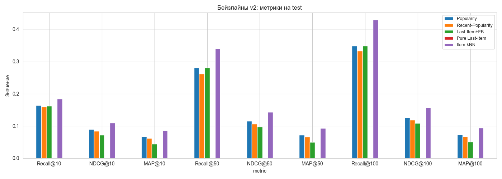
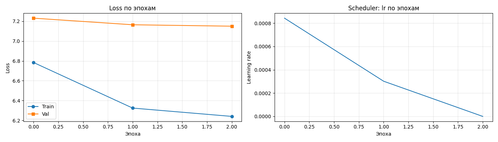

# RL-дообучение рекомендательной модели на датасете KION

Исследовательский проект: дообучение последовательной рекомендательной модели
с помощью обучения с подкреплением (RL) для оптимизации долгосрочных целей
(доля досмотра контента) вместо краткосрочных (клик, лайк) с минимальной потерей релевантности результатов.

---

## Содержание
- [1. Цель проекта](#1-цель-проекта)
- [2. Датасет](#2-датасет)
- [3. Сплит данных](#3-сплит-данных)
- [4. Метрики](#4-метрики)
- [5. Бейзлайны](#5-бейзлайны)
- [6. Базовая GPT-2 (next item prediction)](#6-базовая-gpt-2-next-item-prediction)
- [7. Reward Model](#7-reward-model)
- [8. RL-дообучение](#8-rl-дообучение)
- [9. Анализ](#9-анализ)
- [10. Ограничения](#10-ограничения)
- [11. Воспроизведение](#11-воспроизведение)
- [12. Структура репозитория](#12-структура-репозитория)

---

## 1. Цель проекта

Стандартные рекомендательные системы оптимизируют **краткосрочные** цели:
число кликов, лайков, покупок. Это приводит к кликбейту без удержания пользователя
и повторяющимся рекомендациям в ущерб долгосрочной удовлетворённости пользователя.

**Что исследуется:** можно ли дообучить последовательную рекомендательную модель
с помощью RL так, чтобы она максимизировала **долю просмотра** контента
(`watched_pct`) — прокси долгосрочного интереса.

**Главный вопрос исследования:** удаётся ли улучшить reward **без потери
релевантности** рекомендаций (снижения Recall, NDCG, MAP)?

*Положительный эффект не гарантирован: содержательный разбор того, почему подход не сработал, тоже является ценным результатом.*

---

## 2. Датасет

Используется **KION Dataset** от МТС — датасет рекомендаций для онлайн-кинотеатра.

| Параметр | Значение |
|----------|----------|
| Источник | [irsafilo/KION_DATASET](https://github.com/irsafilo/KION_DATASET) |
| Взаимодействий | 5 476 251 |
| Пользователей | 962 179 |
| Контента | 15 706 |
| Диапазон дат | 13.03.2021 — 22.08.2021 (162 дня) |

**Ключевое поле:** `watched_pct` — доля просмотра контента от 0 до 100.
Используется как целевая переменная reward model.

**Наблюдения из EDA:**
- **Repeat rate = 0%**. Каждый пользователь смотрит каждый фильм ровно один раз.
- 36.9% пользователей имеют ровно 1 взаимодействие (long-tail).
- Распределение `watched_pct` бимодальное: пики на 0 (закрыл сразу) и 100 (досмотрел).
- Платформа быстро растёт: в марте ~15k взаимодействий/день, в августе ~60k.
- 828 строк (0.015%) с NaN в `watched_pct` — удалены.

**Скачивание:**

```bash
curl -L -o data/raw/data_en.zip \
  https://github.com/irsafilo/KION_DATASET/raw/f69775be31fa5779907cf0a92ddedb70037fb5ae/data_en.zip
unzip data/raw/data_en.zip -d data/raw/
```

---

## 3. Сплит данных

Используется глобальный сплит именно **по времени** для
исключения утечки данных из будущего.

**Фильтр холодных:** остаются только те пользователи и айтемы,
которые встречаются в train. Это уменьшает val/test, но гарантирует,
что модель видела историю пользователя.

### Размеры сплитов

| Сплит | Период | До фильтра | После фильтра | Доля |
|-------|--------|-----------:|--------------:|-----:|
| Train | 13.03 — 23.07.2021 | 3 787 046 | 3 787 046 | 82.0% |
| Val   | 24.07 — 03.08.2021 |   583 822 |   371 021 |  8.0% |
| Test  | 04.08 — 22.08.2021 |   1 104 555 |   474 130 | 10.0% |
| **Итого** | | **5 475 423** | **4 632 197** | **100%** |

Большая часть test теряется, и в данном случае это нормально (см. [10. Ограничения](#10-ограничения)).

**Протокол оценки:** в качестве **таргета** выбирается множество айтемов, с которыми пользователь взаимодействовал на *следующий активный день* после *последнего активного дня в соответствующем сплите*.
Протокол выбран так, чтобы приблизить офлайн-оценку к реальному
сценарию рекомендации: **рекомендация появляется сейчас, и пользователь смотрит в ближайшие минуты**. Это позволяет избежать «предсказания таргета через неделю после последнего контакта».

**Контекст** (история пользователя, доступная модели):

- для val:  история в train;
- для test: история в train + val.

| Сплит | Таргетов (пар user-item) | Пользователей | Ср. таргетов на юзера |
|-------|-------------------------:|--------------:|----------------------:|
| Val   | 176 224 | 118 727 | 1.48 |
| Test  | 186 690 | 132 323 | 1.41 |

**Почему именно такой протокол?** Во избежания ситуации, когда последний просмотр придётся на конец test-сплита, т. е. между ним и последним взаимодействием из контекста пройдёт максимальный период времени (19 дней), а предсказание какого-то клика на основе данных трёхнедельной давности - **нечестная задача**.

---

## 4. Метрики

| Метрика | Что измеряет | Формула (для одного таргета) | Диапазон |
|---------|--------------|------------------------------|----------|
| **Recall@K** | Попал ли правильный айтем в топ-K | `1 if rank ≤ K else 0` | 0…1 |
| **NDCG@K** | Попал ли правильный айтем **высоко** в списке | `1 / log2(rank + 1)` | 0…1 |
| **MAP@K** | Как быстро найден правильный айтем | `1 / rank` | 0…1 |

где `rank` — позиция таргета в ранжированном списке (1-индексированная).

Метрики считаются **per target**: если у пользователя 3 таргета
в первом активном дне, каждый даёт вклад в среднее. Это устойчивее,
чем оценка по одному таргету.

**Значения K:** 10, 50, 100 — три сценария использования:
- `K=10` — реальный экран рекомендаций;
- `K=50` — «широкая» выдача;
- `K=100` — верхняя граница для оценки покрытия.

K считается по *полному каталогу*, без сэмплирования негативов — сэмплированные метрики ранжируют модели некорректно.

*Главной метрикой проекта* будет выступать **NDCG@10** как самая сбалансированная. Recall и MAP используем как вспомогательные: Recall показывает «нашли ли
 вообще», MAP — «как быстро»

---

## 5. Бейзлайн

Реализовано **5 классических бейзлайнов**, чтобы задать честную планку
для GPT-2. Все используют один интерфейс `predict(user, context_items, last_date)`,
что позволяет сравнивать их по одному протоколу.

| Бейзлайн | Логика |
|----------|--------|
| **Popularity** | Топ-200 айтемов за весь train — всем пользователям |
| **Recent-Popularity** | Топ-200 за 14 дней до `last_date` пользователя |
| **Last-Item+FB** | Последний просмотренный + popular в хвосте |
| **Pure Last-Item** | Только последний просмотренный (без fallback) |
| **Item-kNN** | Айтемы, часто встречающиеся вместе с историей юзера |

### Результаты на test

Метрики на 186 690 таргетах (first active day per user).

| Метрика | Popularity | Recent-Popularity | Last-Item+FB | Pure Last-Item | **Item-kNN** |
|---------|-----------:|------------------:|-------------:|---------------:|-------------:|
| Recall@10  | 0.1643 | 0.1601 | 0.1614 | 0.0000 | **0.1842** |
| NDCG@10    | 0.0901 | 0.0846 | 0.0720 | 0.0000 | **0.1091** |
| MAP@10     | 0.0670 | 0.0614 | 0.0443 | 0.0000 | **0.0859** |
| Recall@50  | 0.2807 | 0.2622 | 0.2807 | 0.0000 | **0.3402** |
| NDCG@50    | 0.1150 | 0.1066 | 0.0975 | 0.0000 | **0.1429** |
| MAP@50     | 0.0719 | 0.0659 | 0.0493 | 0.0000 | **0.0929** |
| Recall@100 | 0.3490 | 0.3325 | 0.3482 | 0.0000 | **0.4298** |
| NDCG@100   | 0.1261 | 0.1180 | 0.1084 | 0.0000 | **0.1575** |
| MAP@100    | 0.0729 | 0.0669 | 0.0503 | 0.0000 | **0.0942** |



### Наблюдения

- Данные с двух baseline-ов Last-Item+FB и popularity практически идентичны в связи с тем, что было выявлено, что last-item в чистой форме абсолютно неэффективен на этих данных (**repeat rate = 0%**);
- Как вывод из предыдущего, **Pure Last-Item даёт ровно ноль по всем метрикам.**
- Recent-Popularity показывает худшие результаты в сравнении с Popularity
**Причина:** `last_date` у разных пользователей сильно разный (от
   июня до августа), а таргеты всех — в августе. Популярность
   за 14 дней **перед last_date** может быть на 1–2 месяца старше
   таргета. Глобальная популярность за 4 месяца захватывает
   устойчивые хиты, которые люди смотрят месяцами, и это
   оказывается точнее.
- Абслолютным победителем среди классических baseline-ов становится **Item-kNN**


### Планка для GPT-2

GPT-2 должна побить **Item-kNN**:
- NDCG@10 > **0.1091** — критерий успеха;
- Recall@10 > **0.1842** — желательно;
- NDCG@100 > **0.1575** — проверка, что модель хорошо работает
  на всём диапазоне K.

---

## 6. Базовая GPT-2 (next item prediction)

### Архитектура

Модель — **GPT-2 с нуля** (без предобученных весов), сконфигурированная
под задачу next-item prediction.

| Параметр | Значение | Комментарий |
|----------|---------:|-------------|
| `n_layer` | 2 | Количество Transformer-блоков |
| `n_head` | 4 | Количество голов self-attention |
| `n_embd` | 128 | Размер эмбеддингов |
| `n_positions` | 50 | Максимальная длина последовательности |
| `vocab_size` | 14 937 | Размер словаря (item_id + PAD + UNK) |
| `dropout` | 0.2 | Регуляризация |
| **Всего параметров** | **2 315 136** | ~2.3M |

**Почему такая маленькая модель:** для последующего RL важна **скорость итераций**, а не
максимальное качество. По результатам теста видно, что данной эффективности модели достаточно, чтобы впоследствии использовать её как референсную политику для RL.

### Данные для обучения

- **Формат:** последовательности item_id, паддинг **слева** до `max_len=50`.
- **Почему слева:** GPT-2 использует каузальную маску (предсказывает i-ый элемент на основе множеста (0, i-1)) и не должен учиться предсказывать паддинг (что и случится, если PAD будет справа).
- **Спец-токены:** `PAD=0`, `UNK=1`, реальные айтемы с 2.
- **Отфильтровано:** юзеры с 1 айтемом (нечего предсказывать).
  Осталось **451 120** обучающих примеров из 727 645 юзеров.

### Обучение

| Параметр | Значение |
|----------|---------:|
| Оптимизатор | AdamW |
| Learning rate (пик) | 1e-3 |
| Weight decay | 0.01 |
| Scheduler | Cosine с warmup (10%) |
| Batch size | 256 |
| Max epochs | 3 |
| Gradient clipping | 1.0 |
| Dropout | 0.2 |
| Loss | CrossEntropy (ignore PAD) |

**Результаты обучения:**

| Эпоха | Train loss | Val loss | Learning rate |
|-------|-----------:|---------:|--------------:|
| 1 | 6.78 | 7.23 | 8.4e-4 |
| 2 | 6.32 | 7.16 | 3.0e-4 |
| 3 | 6.24 | **7.15** | 0.0 |

**Интерпретация:**
- Начальный loss (случайная модель) ≈ `log(14937) ≈ 9.6`.
- Финальный loss = 7.15 -> **perplexity = exp(7.15) ≈ 1274**.
  Модель сократила неопределённость в ~12 раз.
- Разрыв train/val = 0.91 — умеренное переобучение. Дальше учить бессмысленно: val loss не улучшается.
- Использован `best_model.pt` = веса после 3-й эпохи (лучший val loss).



### Результаты на test

Метрики на 186 690 таргетах (first active day per user).

| Метрика | Popularity | Recent-Pop | Last-Item+FB | Pure Last-Item | Item-kNN | **GPT-2** |
|---------|-----------:|-----------:|-------------:|---------------:|---------:|----------:|
| Recall@10  | 0.1643 | 0.1601 | 0.1614 | 0.0000 | 0.1842 | **0.2016** |
| NDCG@10    | 0.0901 | 0.0846 | 0.0720 | 0.0000 | 0.1091 | **0.1198** |
| MAP@10     | 0.0670 | 0.0614 | 0.0443 | 0.0000 | 0.0859 | **0.0946** |
| Recall@50  | 0.2807 | 0.2622 | 0.2807 | 0.0000 | 0.3402 | **0.3564** |
| NDCG@50    | 0.1150 | 0.1066 | 0.0975 | 0.0000 | 0.1429 | **0.1536** |
| MAP@50     | 0.0719 | 0.0659 | 0.0493 | 0.0000 | 0.0929 | **0.1017** |
| Recall@100 | 0.3490 | 0.3325 | 0.3482 | 0.0000 | 0.4298 | **0.4457** |
| NDCG@100   | 0.1261 | 0.1180 | 0.1084 | 0.0000 | 0.1575 | **0.1681** |
| MAP@100    | 0.0729 | 0.0669 | 0.0503 | 0.0000 | 0.0942 | **0.1029** |

**Прирост GPT-2 относительно бейзлайнов (NDCG@10):**
- к Popularity: **+33%**
- к Item-kNN (лучший бейзлайн): **+9.8%**

### Ключевые наблюдения

1. **GPT-2 бьёт все классические бейзлайны по всем метрикам.**
   Это означает, что модель изучила более релевантные для этого датасета паттерны, нежели те, что используются в стандартных baseline-ах -> обучение проведено не зря.

2. **Наибольший прирост — по NDCG и MAP**, а не по Recall.
   Это означает, что модель не просто попадает в топ-K, она
   **ставит правильный айтем высоко** в списке. Recall (попадание
   в широкий топ-100) вырос умереннее (+22% к Popularity), а NDCG@10
   (позиционное качество) — сильно (+33%). Модель хорошо ранжирует.

3. **Прирост стабилен на всех K** (10, 50, 100). Это не артефакт
   одного среза — модель действительно лучше ранжирует по всему
   диапазону.

4. **Модель крошечная** (2.3M параметров, 2 слоя) — и уже бьёт классику.
   Для последующего RL это идеальная база: быстрая, качественная, легко дообучается.

### Роль в проекте

`best_model.pt` — это **π_ref** (референсная политика). От неё
пойдёт RL-дообучение. Все сравнения в RL будут:
- против GPT-2 (baseline по метрикам);
- против π_ref (по KL-дивергенции).

---

## 7. Reward Model
### TO_DO
## 8. RL-дообучение
### TO_DO
## 9. Анализ
### TO_DO

---

## 10. Ограничения
### Ограничения данных
- Из-за роста платформы теряется примерно 76% test —
большая часть взаимодействий приходится на пользователей, которых не было в train.
Это создаёт оптимистичное смещение метрик (оениваются только «тёплые» юзеры).
- Маскировка уже просмотренных айтемов не нужна. В данном датасете это не влияет на метрики: **repeat rate = 0%**
- Внутри одного дня порядок просмотров неизвестен (в `last_watch_dt`
  только дата без времени). На классических baseline-ах порядок будет соответствовать появлению в датасете, при обучении GPT-2 - случайная перемешка
### Ограничения модели (GPT-2)
- **Оценка на «тёплых» юзерах.** Модель оценивается только на
  пользователях, которые были в train. На новых — не тестируется.
- **Один таргет на юзера в протоколе.** Модель учится предсказывать
  «следующий айтем», но оценивается на «первом активном дне» —
  это может быть 1-3 айтема. В итог идёт усреднённый результат.
- **Max context = 50.** Юзеры с длинной историей обрезаются.
  Влияет на ~5% (5510 юзеров с обрезанной историей).

---

## 11. Воспроизведение
```bash
# 1. Клонировать репозиторий
git clone https://github.com/Sladkiy-Bo/TLabExam
cd kion-recsys-rl

# 2. Виртуальное окружение
python -m venv .venv
source .venv/bin/activate  # Windows: .venv\Scripts\activate

# 3. Установить зависимости
pip install -r requirements.txt

# 4. Скачать датасет (см. раздел 2)
curl -L -o data/raw/data_en.zip <URL>
unzip data/raw/data_en.zip -d data/raw/

# 5. Подготовить сплиты
cd src && python data.py && cd ..

# 6. Запустить ноутбуки
jupyter notebook notebooks/
# 01_eda.ipynb → EDA
# 02_baselines.ipynb → метрики baseline-ов
```

---

## 12. Структура репозитория

```test
TLabExam/
├── data/
│   ├── raw/                # исходные CSV (не коммитятся)
│   └── processed/          # train/val/test.parquet
├── notebooks/
│   ├── 01_eda.ipynb         # разведочный анализ
│   |── 02_baselines.ipynb   # оценка baseline-ов
│   |── 03_protocol.ipynb    # допю исследования для протокола
│   └── 04_baseline_v2.ipynb # новая оенка на основе доработанного протокола
├── src/
│   ├── data.py             # загрузка + временной сплит + фильтр холодных
│   ├── metrics.py          # Recall@K, NDCG@K, MAP@K
│   └── baselines.py        # Popularity, Last-Item
├── results/
│   ├── baselines_metrics.csv
│   |── baselines_metrics.png
|   ├── baselines_v2_metrics.csv
│   └── baselines_v2_metrics.png
├── requirements.txt
├── .gitignore
└── README.md
```